# MIRA: Markerless Interactive Reactive Arm

[](LICENSE)
[](https://www.python.org/)
[](#setup)
[](https://www.intelrealsense.com/depth-camera-d455/)
[](https://www.trossenrobotics.com/)
[](https://mujoco.org/)

**Markerless 6D object tracking driving a reactive robot arm, with a scripted controller and sim-to-real
reinforcement learning.**

[Demo](#demo) · [Results](#results) · [How it works](#how-it-works) · [Setup](#setup) · [Running](#running) ·
[Safety](#safety) · [Roadmap](#roadmap) · [Project report](docs/PROJECT_REPORT.md)

MIRA tracks objects in RGB-D video from their CAD models alone, with no AprilTags or fiducial markers. It closes the
loop to a robot arm fast enough to keep up with a person moving things around. The task is reactive pick-and-place: a
Trossen WidowX AI arm and one fixed Intel RealSense D455 stack a red 5 cm cube on a green one while someone keeps
interfering.

Two controllers share the same perception and safety layer:
- **A scripted controller (the baseline):**
  - it hovers over the red cube and follows it as it moves, then picks it the moment it rests;
  - it follows green at carry height and stacks;
  - it stays awake, so if the stack is knocked over, a grasp misses or red is pulled away, it simply goes again.
- **Reinforcement learning policies,** trained only in simulation (PPO in MuJoCo, against a system-identified model of
  the arm), run unchanged on the real arm.

## Highlights

- **Markerless 6D pose tracking:**
  - color + depth detection, then [M3T](https://github.com/DLR-RM/3DObjectTracking) region and depth tracking, at
    ~60 fps with ~8 ms of compute per frame;
  - every pose is verified against the image before it is used ("never confidently wrong");
  - occlusion-aware: the other object counts as a known occluder.
- **Reactive, closed-loop manipulation:** follows moving objects with about 0.25 s lag, re-plans in about 0.5 s, and
  recovers from missed grasps, drops and knocked-over stacks.
- **Built for human interference:** a person can move, remove or knock over the cubes mid-task.
- **Sim-to-real reinforcement learning:**
  - the policies stack in 72% of simulated trials at the real gripper speed;
  - trained only in simulation, they run unchanged on the real arm and stack in 3.5–5.5 s;
  - they follow cubes moved by hand: the grab still stacked after red was slid up to 19 cm, and the placement set red
    on a green moved 18–21 cm;
  - on 2026-11-01, 19 counted stacks in 60 real attempts while the runner was being fixed. With the final code, 6 of
    15 undisturbed attempts stacked, and 5 of 8 with both cubes in the trained range
    ([all attempts](docs/rl/REPORT.md#second-real-arm-day-release-retry-and-recalibration-rtx-5090-pc-2026-11-01)).
- **Safety first:**
  - every joint path is checked against a workspace box using the arm's MuJoCo model;
  - tracking-error and collision (effort) guards while moving;
  - a finger-clearance check against the real gripper meshes.
- **Tested on real hardware:**
  - 10/10 stacks in a scripted reliability run;
  - 2.1 mm RMS camera-to-arm calibration, and a pick-based check that measures the remaining error at the grasp.

## Demo

**[Demo video (83 s)](docs/media/mira_demo.mp4):** learned stacking, a cube slid by hand, a moved target, recovery
after a knock-over, calibration, and tracking alone, from the 2026-11-01 session.

| Learned policies on the real arm (real time) | The learned grab follows a cube slid by hand (1.5× speed) |
|---|---|
| [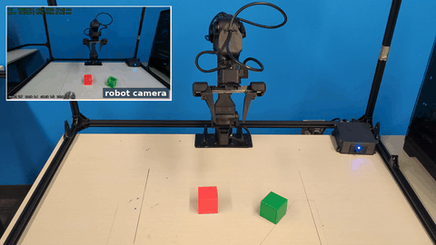](docs/media/mira_demo.mp4) | [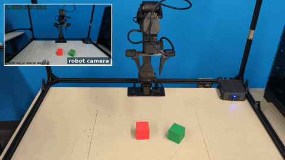](docs/media/mira_demo.mp4) |
| Grab → scripted lift → placement: a counted stack in 3.5 s from the start of the grab. Inset: the robot's camera with the live tracking overlay. | A hand slides red around during the grab. The grab follows it, then the placement stacks it (12.2 s). |
| [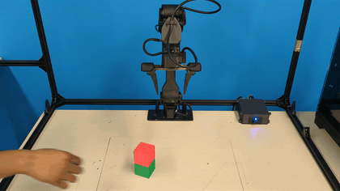](docs/media/rl_session5.mp4) | [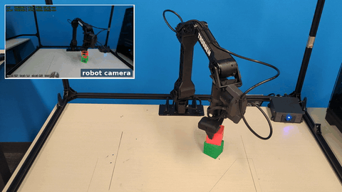](docs/media/mira_demo.mp4) |
| Green is pushed while the arm carries red; the placement follows it and stacks (2026-10-31, 1.5× speed). [Full session (2×)](docs/media/rl_session5.mp4), including the re-grasp failure fixed on 2026-11-01. | A hand knocks red off a finished stack, and the always-on runner stacks it again in 4.2 s (real time). |

The policies were trained only in simulation and run unchanged on the arm, from live markerless tracking
([results](#results), [every attempt](docs/rl/REPORT.md#second-real-arm-day-release-retry-and-recalibration-rtx-5090-pc-2026-11-01)).

| Scripted controller: follows the red cube as it's dragged (real time) | Scripted controller: full cycle while both cubes are moved (2× speed) |
|---|---|
| [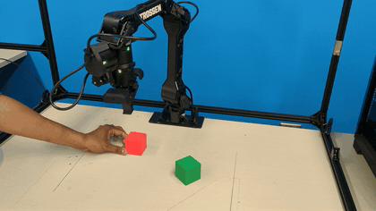](docs/media/follow_red.mp4) | [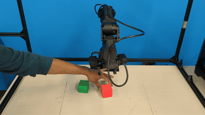](docs/media/full_cycle.mp4) |
| [Full video](docs/media/follow_red.mp4) | [Full video](docs/media/full_cycle.mp4): follows red, picks it the moment it rests, follows green while it is moved, stacks, then re-stacks after the top cube is taken off |

| Calibration: the arm shows the cube to the camera at 18 poses (10× speed) | Real camera: cubes placed close together, tracked live | ...and stacked by the arm |
|---|---|---|
| 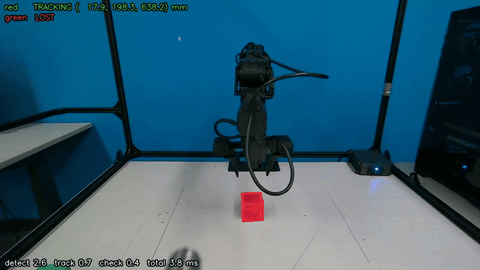 | 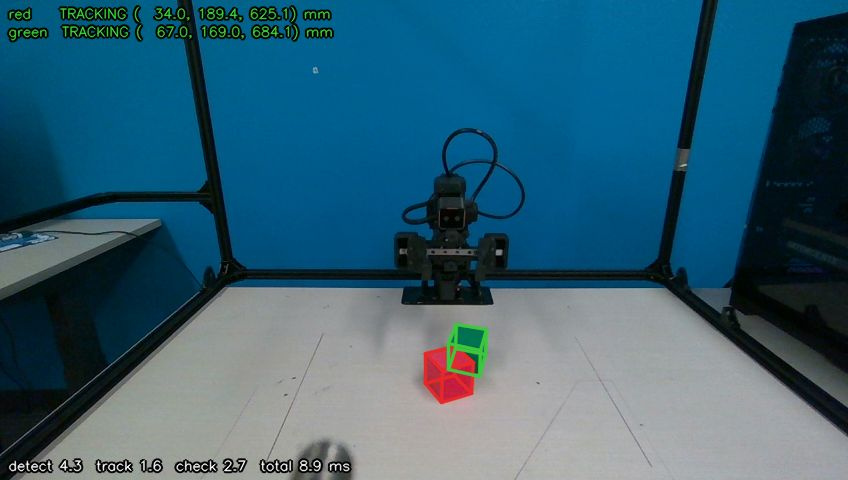 | 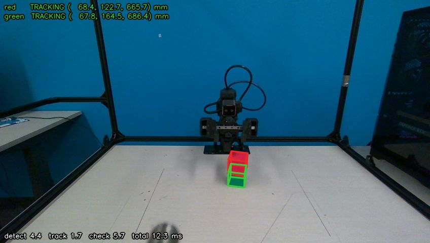 |
| The camera-to-arm calibration needs no markers: the arm picks red and holds it up at 18 poses (2.25 mm RMS in this run). | Live overlay from the D455: both cubes `TRACKING`, with their 6D poses drawn as wireframes, at about 12 ms of compute per frame (timings at the bottom). | |

| Simulation: a hand picks up and moves a cube | A stack is knocked over | A cube is snatched away fast |
|---|---|---|
| 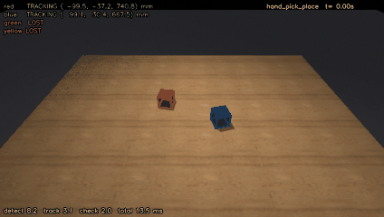 | 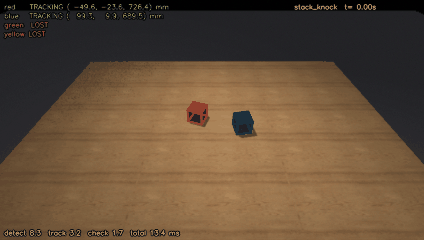 | 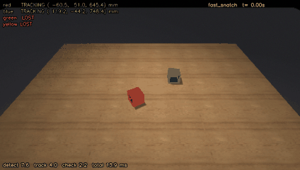 |

Simulation tests of the perception (MuJoCo, with D455-like noise): the tracker re-finds moved cubes within 0 to 1
frames and never reports a wrong pose as `TRACKING` ([details](docs/poc/README.md)).

## Results

| Area | Result |
|---|---|
| Perception | 6D poses of both cubes at **~60 fps**, ~8 ms of compute per frame; a moved cube is re-found in 0–1 frames |
| Perception, simulation check | **0 wrong poses in 16,274 frames** across 7 adversarial scenarios ([docs/poc](docs/poc/README.md)) |
| Camera-to-arm calibration | **2.1 mm RMS** (the arm picks the red cube and shows it to the camera at 18 poses) |
| Scripted stacking | **10/10 stacked**, 9 on the first attempt ([docs/reliability](docs/reliability/run_20261016_174531.md)) |
| Following a moving cube | **~0.25 s** lag; within 0.7 mm over a still cube |
| Arm motion model (system ID) | Streamed motion on firmware 1.9.4 matches the simulator to **0.08°**, with about 0.13 s lag |
| RL, simulation | **72%** stacked over 150 trials in which a simulated hand may move the cubes, at the real gripper speed; **66%** with calibration, tracker, friction and mass errors added ([docs/rl](docs/rl/REPORT.md)) |
| RL, real arm, 2026-10-31 (first test) | Learned grab: **14/14** picked up after the first 3 setup attempts, in about 2 s. **8 of 12** attempts ended stacked, and **4** were counted, in **4.7–7.3 s**. With a person moving the cubes mid-task: **4 of 6** ended stacked (without: 4 of 6). The main failure: re-grasping after the release ([details](docs/rl/REPORT.md#first-real-arm-runs-of-the-rl-chain-rtx-5090-pc-2026-10-31)) |
| RL, real arm, 2026-11-01 | **60 attempts, 19 counted stacks**, median **4.6 s** (3.5–12.2 s), while the runner was being fixed. Final code, no deliberate disturbance: **6 of 15** counted; with both cubes in the trained range at the start: **5 of 8**. **20** safety stops, 11 of them with a cube beyond the trained range. Re-grasping is now stopped by a runner rule ([all 60 attempts](docs/rl/REPORT.md#second-real-arm-day-release-retry-and-recalibration-rtx-5090-pc-2026-11-01)) |

**How to read the real-arm RL numbers:**
- **A counted stack** meets the runner's full rule: red within 10 mm of green's centre, at stack height, upright,
  released and still for 0.5 s.
- **The trained range** is both cubes 20–34 cm from the arm's base. The in-range rule applies to successes and
  failures alike.
- **These are not a benchmark:** the runner changed between sessions, the samples are small, and cube spots weren't
  fixed. A clean benchmark is on the [roadmap](#roadmap).
- **The overall assessment,** with ratings by area and limitations, is in the
  [project report](docs/PROJECT_REPORT.md).

## How it works

### Perception (`perception/`)

Every camera frame goes through three steps:

1. **Global detector** (`detector.py`). A per-color HSV mask feeds a depth-based box fit that gives a 6D cube pose from
   scratch, with no memory between frames, so a cube moved anywhere in view is found again in the next frame. Blobs
   that are not cube-shaped (a hand, a red stick, flat red tape) are rejected.
2. **M3T tracking** (`tracker.py`). DLR-RM's 3DObjectTracking (M3T, through pym3t) refines and tracks each cube from
   color contour and depth.
3. **Consistency check** (`consistency.py`, `table.py`, `pipeline.py`). The tracked cube is ray-cast into the image and
   compared with the color mask and the depth. The other cube counts as a known occluder. Each cube gets a state:
   - `TRACKING`: verified, safe to act on.
   - `OCCLUDED`: mostly hidden; the pose is a best guess.
   - `LOST`: no pose.

   The rule is "never confidently wrong": a pose that fails the check is never reported as `TRACKING`.

### Arm and control (`robot/`)

- **`arm.py`: safety wrapper.** Every command goes through it.
  - Joint limits with a margin.
  - The whole joint path is checked against a workspace box, using forward kinematics from Trossen's MuJoCo model.
  - Speed limits.
  - Tracking-error and unexpected-effort guards.
  - The arm is only braked (idle) at its rest pose.
- **`controller.py`: the always-on controller.**
  - *Watch:* the arm waits at a pose that hides none of the workspace from the camera.
  - *Follow:* it hovers over the red cube and follows it (`follow.py`).
  - *Pick:* once both cubes have rested about 1 s, it plans a top-down grasp. The finger direction is chosen so the
    open gripper keeps 8 mm from the other cube, checked against the real finger meshes. It descends straight from
    the hover point, and stops and re-follows if red is moved on the way down.
  - *Carry:* it follows the green cube at carry height, and lowers once green has rested 0.5 s.
  - *Verify and watch again.*
  - Any failure (missed grasp, drop, bad placement) leads straight to another attempt.
  - Buttons on the live page: Start, Pause, Resume, Go to rest.
- **`follow.py`: hover-and-follow.** Smooth re-aims a few times a second, with the fingers kept along the cube's faces
  and acceleration capped.
- **`stream.py`: streaming (firmware 1.9.x).** A 100 Hz trajectory generator on the PC (1 rad/s, 4 rad/s²) streams
  joint targets to the arm, cutting the lag to about 0.13 s. Every point is still clipped to the arm's joint limits
  and checked by the safety wrapper.
- **`grasp.py`, `ik.py`, `camera_frame.py`:** grasp planning, IK on the MuJoCo model, and the camera-to-base
  transform. The calibration records the camera's serial number, and a different camera is refused until it is
  calibrated.

### Reinforcement learning (`rl/`)

- **Simulator:** MuJoCo with Trossen's model of the arm. `MovingCubeGrasp` (grab red, which a hand may be sliding)
  and `StackCubes` (the whole task, with a hand that may move either cube) start from a mix of situations: cubes on
  the table, red already held, red near or over green.
- **Policies:** PPO (Stable-Baselines3), deciding at 20 Hz from the cube poses relative to the fingertips and the
  arm's state; no images. The task is chained: a grab policy, a short scripted lift, then a placement policy. A
  single end-to-end policy never learned to grasp.
- **Matched to the real arm:** the arm's motion comes from system ID on the real arm (streamed targets match to
  0.08°), the gripper closes at its real speed (about 0.75 s), and the camera's noise and delay are simulated.
  Optional variations add calibration error, tracker bias, and friction and mass changes.
- **On the arm:** `rl/deploy.py` runs the chain through the same safety wrapper and live perception. `--dry` runs it
  against a real-time MuJoCo world instead of the arm.
- **Real-arm tests (2026-10-31 and 2026-11-01), with the policies unchanged:**
  - **The first attempts showed where the real arm differs from the simulator:**
    - the gripper starts closing slowly;
    - a fast open overshoots;
    - fast dives overshoot near the table.

    Each difference is handled in the runner or the arm wrapper.
  - **The placement policy never learned to back off after a stack,** because its training episodes ended there. On
    the arm it grabbed red again after letting go. Now, once it lets go of red over green, the runner stops the arm
    and judges the stack ("release ends placing").
  - **After a failed attempt, the next one starts from where the arm is** ("retry from here").
  - **Stops brake smoothly,** at the trajectory generator's own rate.
- **Docs:** [results and full history](docs/rl/REPORT.md), and
  [how to run the policies on the arm](docs/rl/DEPLOY_CHECKLIST.md).

## Hardware

- **Arm:** Trossen WidowX AI (follower), on Ethernet, firmware 1.9.4 with driver `trossen-arm==1.9.3` (the driver's
  minor version must match the firmware's).
- **Camera:** Intel RealSense D455 on a fixed mount facing the arm, about 0.65 m from the cubes and looking down at
  them; 848×480 at 60 fps, color and depth, on **USB 3**.
- **Cubes:** 5 cm, matte, red and green (other colors are in `assets/colors.yaml`).
- **Computer:** Ubuntu 24.04 with a 12-core CPU and an RTX 4070. RL training is mostly CPU-bound (parallel MuJoCo
  environments).

## Setup

No sudo is needed for the environments:

```bash
scripts/setup_env.sh        # micromamba env "rlwx" (conda-forge) + builds pym3t with RealSense support
alias py=~/micromamba/envs/rlwx/bin/python
```

Run everything from the repository root as `py -m <module>`. M3T builds its cube models into `assets/m3t_models/` on
first use (a few minutes, then cached).

**RL training environment** (PyTorch's CUDA 12.8 wheels bring their own CUDA runtime; only an NVIDIA driver is
needed):

```bash
~/.local/bin/micromamba create -y -n rlwx-train -c conda-forge python=3.12
~/micromamba/envs/rlwx-train/bin/pip install torch==2.11.0 --index-url https://download.pytorch.org/whl/cu128
~/micromamba/envs/rlwx-train/bin/pip install -r rl/requirements-train.txt
alias pyt=~/micromamba/envs/rlwx-train/bin/python
```

**Camera:** install librealsense's udev rules once (`99-realsense-libusb.rules` into `/etc/udev/rules.d/`, needs
sudo) so the D455 opens without root, and plug it into a USB 3 port.

**Arm network:** give the computer a static IP on the arm's subnet, for example 192.168.1.10/24. The scripts default
to the arm at 192.168.1.3; pass `--ip` if yours differs.

## Running

Start the live perception first; everything else reads it.

| What | Command |
|---|---|
| Live perception + browser view (127.0.0.1:8080) | `py -m scripts.web_view --cubes red,green --source realsense` |
| **Always-on follow-and-stack controller** (press Start on the page) | `py -m robot.controller` |
| Follow mode only (hover over red, no grasping) | `py -m scripts.follow_cube` |
| Dry run of either, with no arm (simulated motion, commands from `runs/dry_command.json`) | add `--dry` |
| Camera-to-arm calibration (the arm picks red and shows it to the camera; back up `assets/calibration.yaml` first) | `py -m scripts.calibrate_camera pick --prior-current` |
| Measure a small camera-to-arm xy offset by picking the cube, and save it as a correction | `py -m scripts.pick_bias --save` |
| One scripted stack / a reliability run with retries and a log | `py -m scripts.stack_test` / `py -m scripts.reliability_run --trials 10` |
| Bring-up steps: read the arm, home, gripper, hover, pick | `scripts.check_arm`, `arm_home`, `gripper_test`, `hover_test`, `pick_test` |
| Take the arm to rest from wherever it was left | `py -m scripts.to_rest` |
| Simulation proof of concept (all scenarios, GIFs, plots) | `py -m scripts.eval_sim --gif` |
| Camera check, recording, replay, color tuning | `scripts.check_camera`, `record`, `run_live --source <dir>`, `tune_colors` |
| Train an RL policy (`--env moving_cube` for the grab, `stack` for placement) | `pyt -m rl.train_ppo --env stack --steps 8e6 --envs 12 --name <run>` |
| Evaluate grab → scripted lift → place in simulation | `pyt -m rl.eval_chained runs/rl/<grab>/model runs/rl/<place>/model --episodes 150` |
| Run the RL chain on the arm (add `--dry` for a simulated arm in real time) | `pyt -m rl.deploy runs/rl/<grab>/model runs/rl/<place>/model --stream 100 --grip-mode effort --grip-force 18` |

Trained policies are not in the repository (`runs/` is ignored); [docs/rl/REPORT.md](docs/rl/REPORT.md) lists the
settings each one was trained with. Before running them on the arm, go through
[docs/rl/DEPLOY_CHECKLIST.md](docs/rl/DEPLOY_CHECKLIST.md).

The live page shows the overlay (switchable to depth or color masks), each cube's state and position, fps, compute
time and capture-to-pose latency, the controller's status, and the arm buttons. It listens on localhost only; forward
the port (for example over SSH) to view it from another machine.

## Safety

- Keep a hand on the arm's power switch whenever it can move. The controllers wake the arm only when you press
  **Start**.
- Every move is checked before it runs: joints, the workspace box along the whole path, and a floor for the
  fingertips. It is watched while it runs (tracking error, unexpected effort). Any error pauses and holds; when the
  program exits, the arm goes back to rest.
- Slide or hold cubes low by their sides while the arm follows them: it hovers right above the cube.
- Dry runs (`--dry`) never read the page's buttons, so a test can never drive the real arm.
- D455: never call `hardware_reset()`. In testing it left the camera unresponsive. Unplug and replug instead.

## Layout

```
perception/   detector, M3T tracker wrapper, consistency check, table prior, camera sources, overlay
robot/        safety wrapper, IK, grasp planning, follower, streaming, always-on controller
sim/          MuJoCo bench scene (D455-like noise, hand, distractors), scenarios, render worker
rl/           RL environments (grab, stack), PPO training and evaluation, system-ID fit, real-arm runner
scripts/      live view, calibration, bring-up and stacking tests, follow mode, system ID, sim evaluation, camera tools
assets/       cube colors, calibration, Trossen's MuJoCo arm model and table texture (BSD-3)
docs/         demo media, project report, perception proof of concept, calibration checks, reliability runs, RL report
              and real-arm procedures, original project plan
```

## Roadmap

The arm and camera have been moved to other projects (2026-11-01). The next hardware sessions will cover the following,
in order. The full plan is in the
[project report](docs/PROJECT_REPORT.md#future-plans-when-the-arm-is-ready-again).

1. **Recalibrate:** the camera-to-arm calibration, then a pick check.
2. **Runner robustness** (can be built and dry-tested before the arm is back):
   - start only with both cubes in the trained range;
   - a safer put-back after a safety stop;
   - smoother carries, so fast follows don't trip the base-joint guard.
3. **Placement accuracy:** red lands about 9 mm toward the arm. Measure whether the cause is real overhang or a
   misread of stacked cubes, then correct it.
4. **Retrain the placement policy** to release at stack height and back off by itself, replacing the runner's rule.
   Train it with the real gripper's closing profile and a slower dive near the table.
5. **A clean benchmark:**
   - fixed cube spots;
   - the scripted controller and the RL chain, 20+ trials each, on the same day with the same code;
   - a disturbance protocol: red slid during the grab, green pushed during the carry, the stack knocked over.

**Known issues:**
- **The calibration is out of date.** The calibration in the repository predates the arm's move. On 2026-11-01, a
  remount alone shifted it by about 5 mm.
- **The base-joint effort guard (2.3 Nm) trips on fast carries,** when the target cube is pushed far.
- **Follow mode** ran on firmware 1.9.4 on 2026-11-01, for about 2 minutes, with one tracking-error stop. The scripted
  controller hasn't been re-benchmarked on 1.9.4.
- **Stacked cubes read 4–5 mm short;** the fix is a stack prior in perception.
- **In simulation, knocking a cube over** is the main remaining failure.

The original project plan, and how each phase turned out, is in [docs/PLAN.md](docs/PLAN.md).

## Notes

<details>
<summary><b>Graphics: M3T, GLFW and Wayland</b></summary>

M3T's GLEW is built for GLX. GLFW 3.5 picks Wayland when a Wayland session is running (Ubuntu's default desktop, or
WSLg), and then GLEW can't initialize, so `perception/__init__.py` keeps GLFW on X11. On a headless machine, run
perception under `xvfb-run -a`. MuJoCo rendering runs in a separate process (`sim/render_worker.py`), because M3T calls
`glfwTerminate` after it builds its models.

</details>

<details>
<summary><b>Running under Windows + WSL2</b></summary>

MIRA was first developed on Windows 11 + WSL2. There, the camera stays on Windows (no usbipd needed): run the streamer
with a Windows Python that has `pyrealsense2`:

```powershell
python scripts\win_camera_stream.py --host 127.0.0.1 --wb 3000
```

With WSL **mirrored networking**, WSL sees it at 127.0.0.1:5600, which is `scripts.web_view`'s default source.
Mirrored networking is also required for the arm, whose UDP stream doesn't reach WSL behind NAT: set
`networkingMode=mirrored` under `[wsl2]` in `%UserProfile%\.wslconfig`.

</details>

## Acknowledgments

- [DLR-RM/3DObjectTracking](https://github.com/DLR-RM/3DObjectTracking) (M3T) and its Python bindings
  [pym3t](https://github.com/agimus-project/pym3t), cloned and built by `scripts/setup_env.sh`.
- [Trossen Robotics](https://github.com/TrossenRobotics) for the WidowX AI driver, the MuJoCo model in
  `assets/trossen_arm_mujoco` and the table texture `assets/maple_tabletop.png`, both from their
  `trossen_arm_mujoco` package (BSD 3-Clause, see `assets/LICENSE.trossen_arm_mujoco`).

## License

Copyright (c) 2026 Apurv Kushwaha. All rights reserved. The source is public to read, but it is not licensed for
use, copying, modification or redistribution without written permission (see [LICENSE](LICENSE)). To ask for
permission, open an issue.

Trossen's MuJoCo model in `assets/trossen_arm_mujoco` and its table texture `assets/maple_tabletop.png` keep
their own BSD 3-Clause license (`assets/LICENSE.trossen_arm_mujoco`).

## Citation

If MIRA is useful in your work, please cite it:

```bibtex
@software{mira_manipulation,
  author = {Kushwaha, Apurv},
  title  = {{MIRA}: Markerless Interactive Reactive Arm},
  year   = {2026},
  url    = {https://github.com/ApurvK032/mira-manipulation}
}
```
