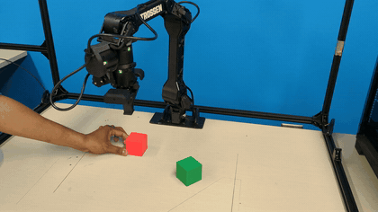
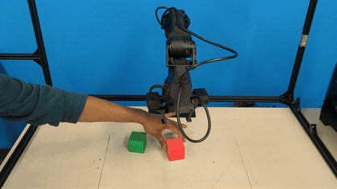
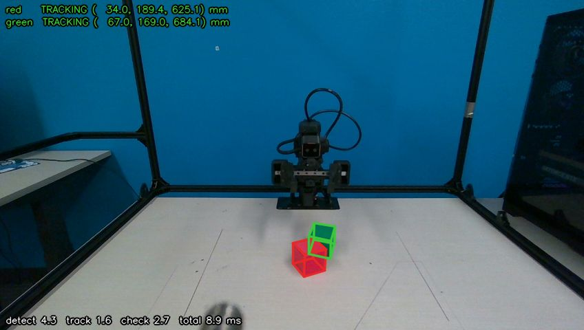
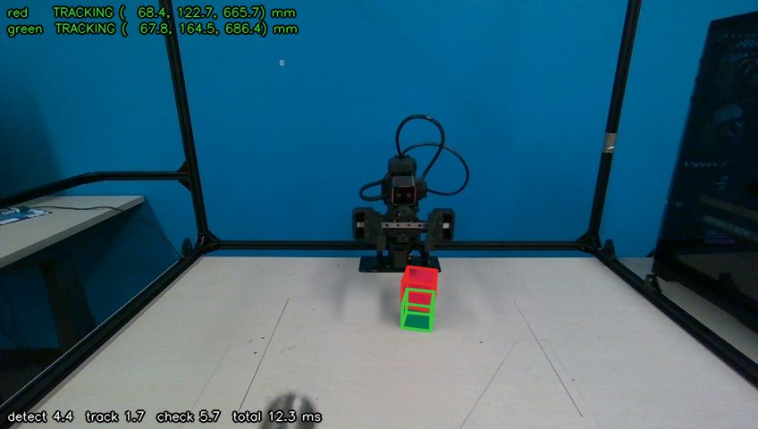
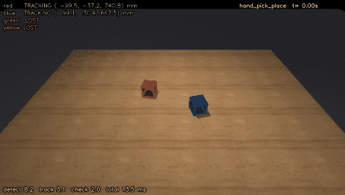
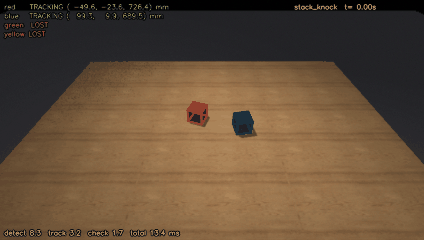
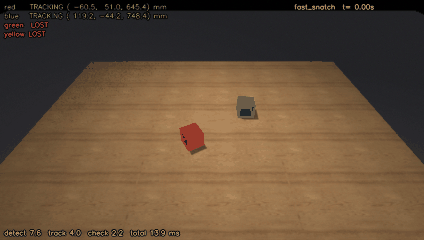

# MIRA: Markerless Interactive Reactive Arm

[](LICENSE)
[](https://www.python.org/)
[](#setup)
[](https://www.intelrealsense.com/depth-camera-d455/)
[](https://www.trossenrobotics.com/)
[](https://mujoco.org/)

**Markerless 6D object pose tracking driving a reactive robot arm.** MIRA tracks objects from their CAD
models in RGB-D video, with no AprilTags or fiducial markers, and closes the loop to a robot arm fast
enough to keep up with a person moving things around. The first task is reactive pick-and-place: stacking
one cube on another while someone keeps interfering.

A Trossen WidowX AI arm and one fixed Intel RealSense D455 stack a red 5 cm cube on a green one. The arm
hovers over the red cube and follows it as it is moved (position-based visual servoing). It picks red
the moment it comes to rest, follows green at carry height if green is moved, stacks, then stays awake:
if the stack is knocked over, a grasp misses or red is pulled away mid-grasp, it simply goes again. A
scripted controller drives the arm today and is the baseline. Reinforcement learning policies trained in
MuJoCo against a model of this arm are next: they stack in simulation and are being brought to the real
arm (see [Reinforcement learning](#reinforcement-learning-rl), [Roadmap](#roadmap) and [PLAN.md](PLAN.md)).

**Highlights**
- **Markerless 6D pose tracking:**
  - color + depth detection, then [M3T](https://github.com/DLR-RM/3DObjectTracking) region and depth tracking, at ~60 fps with ~8 ms compute per frame;
  - every pose is verified against the image before it is used ("never confidently wrong");
  - occlusion-aware: the other object counts as a known occluder.
- **Reactive, closed-loop manipulation:** follows moving objects with about 0.25 s lag, re-plans in about 0.5 s, and recovers from missed grasps, drops and knocked-over stacks.
- **Human-robot interaction:** built for a person moving, removing and knocking over objects mid-task.
- **Safety first:**
  - every joint path is checked against a workspace box using the arm's MuJoCo model;
  - tracking-error and collision (effort) guards while moving;
  - a finger-clearance check against the real gripper meshes.
- **Tested on real hardware:** 10/10 stacks in a scripted reliability run, and 2.1 mm RMS camera-to-arm calibration.
- **Sim-to-real reinforcement learning (in progress):** PPO policies in MuJoCo, trained against a
  system-identified model of the real arm and its gripper while a simulated hand moves the cubes.
  They stack in 72% of simulated trials; they have not yet stacked on the real arm.

## Demo

| Follows the red cube as it's dragged (real time) | Full cycle while both cubes are moved (2× speed) |
|---|---|
| [](docs/media/follow_red.mp4) | [](docs/media/full_cycle.mp4) |
| [Full video](docs/media/follow_red.mp4) | [Full video](docs/media/full_cycle.mp4): follows red, picks it the moment it rests, follows green while it is moved, stacks, then re-stacks after the top cube is taken off |

| Real camera: cubes placed close together, tracked live | ...and stacked by the arm |
|---|---|
|  |  |

Live overlay from the D455: both cubes `TRACKING` with their 6D poses drawn as wireframes, about 12 ms of
compute per frame (detect / track / check shown at the bottom).

| Simulation: a hand picks up and moves a cube | A stack is knocked over | A cube is snatched away fast |
|---|---|---|
|  |  |  |

Simulation tests of the perception (MuJoCo, with D455-like noise): the tracker re-finds moved cubes within
0 to 1 frames and never reports a wrong pose as `TRACKING` ([details](docs/poc/README.md)).

## Results

| | |
|---|---|
| Perception | 6D poses of both cubes at **~60 fps**, ~8 ms compute per frame; a moved cube is re-found in 0–1 frames |
| Simulation check | **0 wrong poses in 16,274 frames** across 7 adversarial scenarios ([docs/poc](docs/poc/README.md)) |
| Camera-to-arm calibration | **2.1 mm RMS** (the arm picks the red cube and shows it to the camera at 18 poses) |
| Scripted stacking | **10/10 stacked**, 9 on the first attempt ([docs/reliability](docs/reliability/run_20261016_174531.md)) |
| Following a moving cube | **~0.25 s** lag; within 0.7 mm over a still cube |
| Arm motion model (system ID) | Streamed motion on firmware 1.9.4 matches the simulator to **0.08°**; about 0.13 s lag |
| RL, simulation only | **72%** stacked over 150 trials in which a simulated hand may move the cubes, at the real gripper speed; 66% with calibration, tracker, friction and mass errors added ([docs/rl](docs/rl/REPORT.md)) |

## How it works

### Perception (`perception/`)

Every camera frame goes through three steps:

1. **Global detector** (`detector.py`). A per-color HSV mask feeds a depth-based box fit that gives a
   6D cube pose from scratch, with no memory between frames, so a cube moved anywhere in view is found
   again in the next frame. Blobs that are not cube-shaped (a hand, a red stick, flat red tape) are
   rejected.
2. **M3T tracking** (`tracker.py`). DLR-RM's 3DObjectTracking (M3T, through pym3t) refines and tracks
   each cube from color contour and depth.
3. **Consistency check** (`consistency.py`, `table.py`, `pipeline.py`). The tracked cube is ray-cast
   into the image and compared with the color mask and the depth. The other cube counts as a known
   occluder. Each cube gets a state:
   - `TRACKING`: verified, safe to act on.
   - `OCCLUDED`: mostly hidden; the pose is a best guess.
   - `LOST`: no pose.
   The rule is "never confidently wrong": a pose that fails the check is never reported as `TRACKING`.

### Arm and control (`robot/`)

- **`arm.py`: safety wrapper.** Every command goes through it.
  - Joint limits with a margin.
  - The whole joint path is checked against a workspace box, using forward kinematics from Trossen's
    MuJoCo model.
  - Speed limits.
  - Tracking-error and unexpected-effort guards.
  - The arm is only braked (idle) at its rest pose.
- **`controller.py`: the always-on controller.**
  - *Watch:* the arm waits at a pose that hides none of the workspace from the camera.
  - *Follow:* it hovers over the red cube and follows it (`follow.py`).
  - *Pick:* once both cubes have rested about 1 s, it plans a top-down grasp. The finger direction is
    chosen so the open gripper keeps 8 mm from the other cube, checked against the real finger meshes.
    It descends straight from the hover point, and stops and re-follows if red is moved on the way down.
  - *Carry:* it follows the green cube at carry height, and lowers once green has rested 0.5 s.
  - *Verify and watch again.*
  - Any failure (missed grasp, drop, bad placement) leads straight to another attempt.
  - Buttons on the live page: Start, Pause, Resume, Go to rest.
- **`follow.py`: hover-and-follow.** Smooth re-aims a few times a second, with the fingers kept along
  the cube's faces and acceleration capped.
- **`stream.py`: streaming (firmware 1.9.x).** A 100 Hz trajectory generator on the PC (1 rad/s,
  4 rad/s²) streams joint targets to the arm, cutting the lag to about 0.13 s. Every point is still
  clipped to the arm's joint limits and checked by the safety wrapper.
- **`grasp.py`, `ik.py`, `camera_frame.py`:** grasp planning, IK on the MuJoCo model, and the
  camera-to-base transform. The calibration records the camera's serial number, and a different camera
  is refused until it is calibrated.

### Reinforcement learning (`rl/`)

- **Simulator:** MuJoCo with Trossen's model of the arm. `MovingCubeGrasp` (grab red, which a hand may
  be sliding) and `StackCubes` (the whole task, with a hand that may move either cube) start from a mix
  of situations: cubes on the table, red already held, red near or over green.
- **Policies:** PPO (Stable-Baselines3), deciding at 20 Hz from the cube poses relative to the
  fingertips and the arm's state; no images. The task is chained: a grab policy, a short scripted lift,
  then a placement policy. A single end-to-end policy never learned to grasp.
- **Matched to the real arm:** the arm's motion comes from system ID on the real arm (streamed targets
  match to 0.08°), the gripper closes at its real speed (about 0.75 s), and the camera's noise and
  delay are simulated. Optional variations add calibration error, tracker bias, and friction and mass
  changes.
- **On the arm:** `rl/deploy.py` runs the chain through the same safety wrapper and live perception.
  `--dry` runs it against a real-time MuJoCo world instead of the arm.
- Details and the full history: [docs/rl/REPORT.md](docs/rl/REPORT.md). Real-arm checklist:
  [docs/rl/DEPLOY_CHECKLIST.md](docs/rl/DEPLOY_CHECKLIST.md).

## Hardware

- **Arm:** Trossen WidowX AI (follower), on Ethernet, firmware 1.9.4 with driver `trossen-arm==1.9.3`
  (the driver's minor version must match the firmware's).
- **Camera:** Intel RealSense D455 on a fixed mount facing the arm, about 0.65 m from the cubes and
  looking down at them; 848×480 at 60 fps, color and depth, on **USB 3**.
- **Cubes:** 5 cm, matte, red and green (other colors are in `assets/colors.yaml`).
- **Computer:** Ubuntu 24.04 with a 12-core CPU and an RTX 4070. RL training is mostly CPU-bound
  (parallel MuJoCo environments).

## Setup

No sudo is needed for the environments:

```bash
scripts/setup_env.sh        # micromamba env "rlwx" (conda-forge) + builds pym3t with RealSense support
alias py=~/micromamba/envs/rlwx/bin/python
```

Run everything from the repo root as `py -m <module>`. M3T builds its cube models into
`assets/m3t_models/` on first use (a few minutes, then cached).

**RL training env** (PyTorch's CUDA 12.8 wheels bring their own CUDA runtime; only an NVIDIA driver is
needed):

```bash
~/.local/bin/micromamba create -y -n rlwx-train -c conda-forge python=3.12
~/micromamba/envs/rlwx-train/bin/pip install torch==2.11.0 --index-url https://download.pytorch.org/whl/cu128
~/micromamba/envs/rlwx-train/bin/pip install -r rl/requirements-train.txt
alias pyt=~/micromamba/envs/rlwx-train/bin/python
```

**Camera:** install librealsense's udev rules once (`99-realsense-libusb.rules` into
`/etc/udev/rules.d/`, needs sudo) so the D455 opens without root, and plug it into a USB 3 port.

**Arm network:** give the computer a static IP on the arm's subnet, for example 192.168.1.10/24. The
scripts default to the arm at 192.168.1.3; pass `--ip` if yours differs.

## Running

Start the live perception first; everything else reads it.

| What | Command |
|---|---|
| Live perception + browser view (127.0.0.1:8080) | `py -m scripts.web_view --cubes red,green --source realsense` |
| **Always-on follow-and-stack controller** (press Start on the page) | `py -m robot.controller` |
| Follow mode only (hover over red, no grasping) | `py -m scripts.follow_cube` |
| Dry run of either, with no arm (simulated motion, commands from `runs/dry_command.json`) | add `--dry` |
| Camera-to-arm calibration (the arm picks red and shows it to the camera; back up `assets/calibration.yaml` first) | `py -m scripts.calibrate_camera pick --prior-current` |
| One scripted stack / a reliability run with retries and a log | `py -m scripts.stack_test` / `py -m scripts.reliability_run --trials 10` |
| Bring-up steps: read the arm, home, gripper, hover, pick | `scripts.check_arm`, `arm_home`, `gripper_test`, `hover_test`, `pick_test` |
| Take the arm to rest from wherever it was left | `py -m scripts.to_rest` |
| Simulation proof of concept (all scenarios, GIFs, plots) | `py -m scripts.eval_sim --gif` |
| Camera check, recording, replay, color tuning | `scripts.check_camera`, `record`, `run_live --source <dir>`, `tune_colors` |
| Train an RL policy (`--env moving_cube` for the grab, `stack` for placement) | `pyt -m rl.train_ppo --env stack --steps 8e6 --envs 12 --name <run>` |
| Evaluate grab → scripted lift → place in simulation | `pyt -m rl.eval_chained runs/rl/<grab>/model runs/rl/<place>/model --episodes 150` |
| Run the RL chain on the arm (add `--dry` for a simulated arm in real time) | `pyt -m rl.deploy runs/rl/<grab>/model runs/rl/<place>/model --stream 100 --grip-mode effort --grip-force 18` |

Trained policies are not in the repo (`runs/` is ignored); [docs/rl/REPORT.md](docs/rl/REPORT.md) lists
the settings each one was trained with.

The live page shows the overlay (switchable to depth or color masks), each cube's state and position,
fps, compute time and capture-to-pose latency, the controller's status, and the arm buttons. It
listens on localhost only; forward the port (for example over SSH) to view it from another machine.

## Safety

- Keep a hand on the arm's power switch whenever it can move. The controller wakes the arm only when
  you press **Start**.
- Every move is checked before it runs: joints, the workspace box along the whole path, and a floor
  for the fingertips. It is watched while it runs (tracking error, unexpected effort). Any error pauses
  and holds; when the program exits, the arm goes back to rest.
- Slide or hold cubes low by their sides while the arm follows them: it hovers right above the cube.
- Dry runs (`--dry`) never read the page's buttons, so a test can never drive the real arm.
- D455: never call `hardware_reset()`. In testing it left the camera unresponsive. Unplug and replug instead.

## Layout

```
perception/   detector, M3T tracker wrapper, consistency check, table prior, camera sources, overlay
robot/        safety wrapper, IK, grasp planning, follower, always-on controller
sim/          MuJoCo bench scene (D455-like noise, hand, distractors), scenarios, render worker
rl/           RL environments (grab, stack), PPO training and evaluation, system-ID fit, real-arm runner
scripts/      live view, calibration, bring-up and stacking tests, follow mode, system ID, sim evaluation, camera tools
assets/       cube colors, calibration, Trossen's MuJoCo arm model (BSD-3), table texture
docs/         proof of concept (sim), calibration checks, reliability runs, RL report and real-arm checklist
PLAN.md       project plan and phase status
```

## Roadmap

- **RL on the real arm.** The first runs of the grab → lift → place chain with 100 Hz streaming: still
  cubes first, then a person moving them.
- **Fewer knock-overs.** Knocking a cube over is the main remaining failure in simulation.
- **Disturbance benchmark.** Success rate, time to stack, reaction time and smoothness while a person
  interferes, comparing the scripted controller with RL.
- **Known issues:**
  - The base-joint effort guard tripped during fast following on firmware 1.8.3. The arm is now on
    1.9.4, where 100 Hz streaming is smooth in system-ID tests; the follower hasn't been re-tested on it
    yet.
  - Placement lands about 4 mm short in x, which points to a calibration bias.
  - Stacked cubes read 4–5 mm short; the fix is a stack prior in perception.

## Graphics note

M3T's GLEW is built for GLX. GLFW 3.5 picks Wayland when a Wayland session is running (Ubuntu's default
desktop, or WSLg), and then GLEW can't initialize, so `perception/__init__.py` keeps GLFW on X11. MuJoCo
rendering runs in a separate process (`sim/render_worker.py`), because M3T calls `glfwTerminate` after it
builds its models.

## Running under WSL2

MIRA was first developed on Windows 11 + WSL2. There, the camera stays on Windows (no usbipd needed):
run the streamer with a Windows Python that has `pyrealsense2`:

```powershell
python scripts\win_camera_stream.py --host 127.0.0.1 --wb 3000
```

With WSL **mirrored networking**, WSL sees it at 127.0.0.1:5600, which is `scripts.web_view`'s default
source. Mirrored networking is also required for the arm, whose UDP stream doesn't reach WSL behind NAT:
set `networkingMode=mirrored` under `[wsl2]` in `%UserProfile%\.wslconfig`.

## Acknowledgments

- [DLR-RM/3DObjectTracking](https://github.com/DLR-RM/3DObjectTracking) (M3T) and its Python bindings
  [pym3t](https://github.com/agimus-project/pym3t), cloned and built by `scripts/setup_env.sh`.
- [Trossen Robotics](https://github.com/TrossenRobotics) for the WidowX AI driver and the MuJoCo model
  in `assets/trossen_arm_mujoco` (BSD 3-Clause, see `assets/LICENSE.trossen_arm_mujoco`).

## License

Copyright (c) 2026 Apurv Kushwaha. All rights reserved. The source is public to read, but it is not licensed for
use, copying, modification or redistribution without written permission (see [LICENSE](LICENSE)). To ask for
permission, open an issue.

The Trossen MuJoCo model in `assets/trossen_arm_mujoco` keeps its own BSD 3-Clause license.

## Citation

If MIRA is useful in your work, please cite it:

```bibtex
@software{mira_manipulation,
  author = {K, Apurv},
  title  = {{MIRA}: Markerless Interactive Reactive Arm},
  year   = {2026},
  url    = {https://github.com/ApurvK032/mira-manipulation}
}
```
