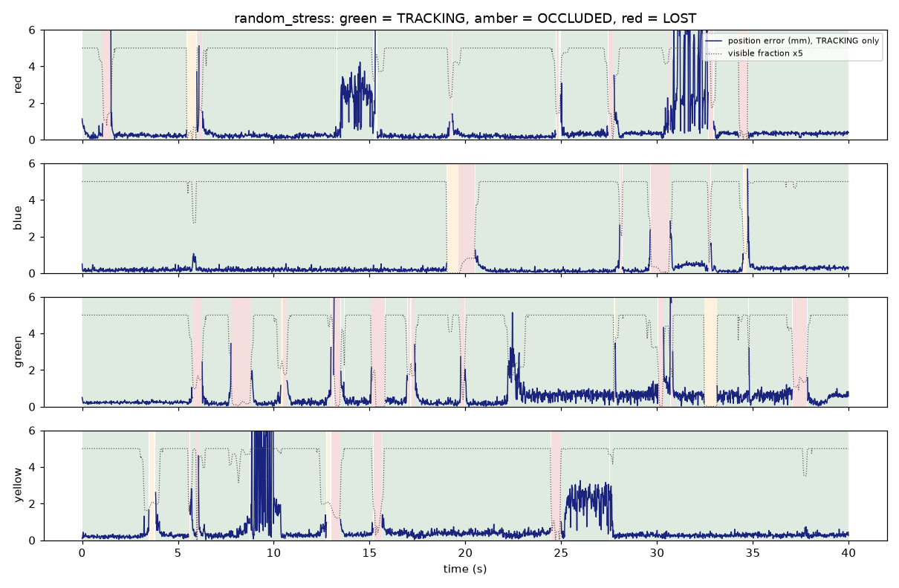
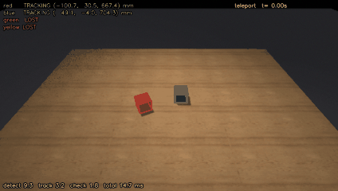

# Cube perception without AprilTags: proof of concept (simulation)

**Question.** Can 5 cm colored cubes be tracked without tags, using DLR-RM's 3DObjectTracking (M3T),
fast enough that a cube moved by hand is found again right away, and accurately enough to stack?

**Answer in simulation: yes.**
- **No confident errors:** across 16,274 cube-frames, no cube was ever reported `TRACKING` with an error
  over 10 mm or 10°.
- **Moved cubes are found again in 0–1 frames** (at most 17 ms at 60 fps): after a teleport, a hand
  placing it, or a knock-over.
- **Accuracy:** median 0.3–0.6 mm and 0.5–1°. At rest, jitter is 0.2 mm.
- **Compute:** 6.3 ms per frame (p95 7.2 ms) for the task's 2 cubes, CPU only, on 8 cores.

The real camera is next. See [the lab checklist](#in-the-lab) at the end.

## How it works

Each 848x480 color + depth frame goes through three steps:

1. **Global detector, every frame, no memory.** For each cube color:
   - An HSV mask and connected blobs.
   - A RANSAC fit of one or two faces to the depth points, which gives a 6D pose.
   - Rejection of blobs that aren't cubes: too big (hand, red stick), or flush with what surrounds
     them (red tape, paper). This step is what finds a moved cube in the very next frame.
2. **M3T tracking, one tracker per cube** (color-contour and depth modalities, via pym3t). It
   refines the pose to sub-millimeter precision. M3T's depth term is reweighted to the scale of a
   5 cm cube (see below).
3. **Verification, every frame.** The pose is ray-cast into the image and compared with the color mask
   and the depth.
   - **What counts as hidden:** pixels covered by something in front, such as a hand or another known
     cube. Something in front with the cube's own color doesn't count, because a cube can't hide behind
     itself.
   - **Priors:**
     - A cube resting on the table or on another cube must be face-up.
     - A partly hidden cube that isn't moving keeps its last fully verified rotation.
     - A fast-moving, mostly hidden cube (being carried by a hand) is only `OCCLUDED`.
   - **States:** `TRACKING` means verified, so the robot can act on it. `OCCLUDED` means a best guess.
     `LOST` means there is no pose. When verification fails, M3T is restarted from the detector in
     the same frame.

## Simulated bench

*White wireframe: ground truth. Colored wireframe: estimate, drawn when `TRACKING`. Amber: `OCCLUDED`.*

- **Scene:** MuJoCo; a wood table; matte 5 cm cubes in red, blue, green and yellow.
- **Hand:** skin-colored. It grabs, carries (at up to 3 m/s), places, stacks and knocks cubes over.
- **Look-alikes:** a red 12 cm stick and a flat red square ("tape").
- **Lighting:** drops to 35% and flickers.
- **Camera like a D455:** 848x480 at 60 fps, about 0.7 m from the cubes, 45° down.
  - Color: 8 ms exposure with motion blur, plus sensor noise.
  - Depth: stereo noise growing with distance squared (about 1 mm at 0.7 m), dropouts at depth edges,
    and random holes.
- **Compute:** perception runs on 8 CPU cores of this machine, with no GPU. Rendering runs in a
  separate process on other cores.
- **Runs:** 8 scripted scenarios, 5,137 frames in total.

## Results

Run with `py -m scripts.eval_sim --gif`; raw numbers are in [results_m3t.json](results_m3t.json).
The evaluation looks for all 4 colors in every scenario, and its compute times include slowdown from
the software renderer running on the other cores at the same time. Clean timings are in the pass-bar
table below.
"Wrong" means marked `TRACKING` with error > 10 mm or > 10°. Errors are measured only on `TRACKING`
frames.

| Scenario | Frames | Wrong `TRACKING` cube-frames | Position error median / p95 / max (mm) | Rotation error median / p95 / max (deg) | Compute p50 / p95 (ms) |
|---|---|---|---|---|---|
| static | 180 | 0 of 360 | 0.36 / 0.50 / 1.09 | 0.51 / 1.07 / 1.28 | 11.0 / 12.5 |
| small_motion | 420 | 0 of 840 | 0.56 / 0.78 / 0.87 | 0.70 / 1.25 / 1.66 | 11.1 / 12.1 |
| hand_pick_place | 442 | 0 of 884 | 0.51 / 0.69 / 2.74 | 0.50 / 1.11 / 3.68 | 11.2 / 12.6 |
| fast_snatch (3 m/s) | 296 | 0 of 592 | 0.34 / 0.97 / 2.68 | 0.50 / 1.19 / 1.82 | 11.0 / 12.1 |
| teleport | 420 | 0 of 840 | 0.37 / 0.80 / 1.73 | 0.61 / 1.60 / 2.19 | 10.9 / 12.1 |
| stack_knock | 379 | 0 of 758 | 0.42 / 3.03 / 3.93 | 0.86 / 2.60 / 3.76 | 11.2 / 13.0 |
| clutter_light (4 cubes) | 600 | 0 of 2400 | 0.32 / 1.53 / 4.59 | 1.10 / 1.47 / 6.72 | 16.6 / 18.8 |
| random_stress (4 cubes, 40 s) | 2400 | 0 of 9600 | 0.41 / 2.39 / 8.19 | 0.89 / 1.70 / 8.79 | 17.4 / 19.8 |

**Finding a cube again after it moves.** Times are counted from the first frame in which at least half
of the cube is visible again (for a teleport, from the jump itself).

| Event | Count | Frames until `TRACKING` and within 5 mm / 5°: median / max | Not found again |
|---|---|---|---|
| Teleport: the cube jumps 6–24 cm between two frames, the worst case | 6 | 1 / 1 (17 ms) | 0 |
| Hand puts the cube down (0.3–3 m/s carries) | 20 | 0 / 1 (≤ 17 ms) | 0 |
| Stacked cube knocked off | 3 | 0 / 0 | 0 |

**Held-out check.** The fixes above were developed against these scenarios. To check they weren't
tuned to them, I re-ran the randomized scenarios with a new seed the pipeline had never seen: new
approach directions, teleport spots and stress events (`py -m scripts.eval_sim --seed 100
--scenarios hand_pick_place,teleport,random_stress`). The result was again **0 wrong `TRACKING` frames
out of 11,284**. All 7 teleports were found again in 1 frame, and all 15 releases and 4 knocks in
0–1 frames. Median errors were 0.3–0.5 mm and 0.5–0.9°.

**Coverage.** Whenever at least 60% of a cube is visible, it is `TRACKING` in 97.4–100% of frames,
depending on the scenario. The lowest figure is the bottom cube of a stack. Under dim (35%) and
flickering light, all four cubes are `TRACKING` 100% of the time when they aren't hidden.

 

### Against the Phase 1 pass bars ([PLAN.md](../PLAN.md))

| Test | Bar | Simulation |
|---|---|---|
| Static jitter | position σ < 1 mm, yaw σ < 0.5° | **pass**: 0.20–0.25 mm, 0.19–0.29° |
| Small motion | a 10 mm push measures 10 ± 1 mm, seen in the next frame | **pass**: 9.62 and 9.94 mm, lag ≤ 1 frame. A 2 mm push measures 1.27 mm. |
| Fast move | `TRACKING` within 3 frames; no wrong frames | **pass**: ≤ 1 frame, 0 wrong |
| Hand clutter | 0 wrong frames | **pass** (simulated hand) |
| Partial occlusion | correct or `LOST`, never wrong | **pass** |
| Stack | both tracked, height 50 ± 2 mm | **partial**: both tracked in 101 of 101 stacked frames, but the centers are 47.5 ± 0.7 mm apart (bottom cube biased about 2.5 mm upward) |
| Lighting | hand-clutter bar still met | **pass** |
| Absolute accuracy | < 3 mm | **pass**: median 0.3–0.6 mm, p95 ≤ 3.0 mm |
| Compute latency | p95 < 10 ms for 2 cubes | **pass**: 6.3 ms p50, 7.2 ms p95, 9.2 ms max (replaying a recording on 8 cores, looking for 2 colors). Looking for all 4 colors: 8.1 / 8.9 ms. |

## What the simulation taught us (each fix came from a failing scenario)

| Problem seen | Fix |
|---|---|
| M3T settled on a cube rotated 20–25° with the same outline | M3T's depth term defaults to 2–5 cm standard deviation, so it has almost no say against the contour term. Weighting it to the cube's scale (3–20 mm) removed these failures; median rotation error is now 0.5°. |
| A pose 10° off still passed the check | Depth agreement turned out to be the reliable signal: correct poses score ≥ 0.95 in 99.96% of frames. It is now required at ≥ 0.95. |
| A faint red "ghost" on the table, from motion blur, accepted as a cube | Flat-patch rejection: a cube must stand out in depth from its surroundings. This also rejects red tape and paper. |
| The bottom cube of a stack went `LOST` | Other tracked cubes are ray-cast as known occluders. |
| A wrong pose hid "behind" the real cube | A cube can't be occluded by its own color. |
| Rotation drifted when something passed in front of a cube at rest | Hold the last fully verified rotation while partly hidden and not moving. |
| 50 ms stalls every 30 frames | BLAS and OpenMP thread pools fighting; fixed with one BLAS thread and passive OpenMP waiting. |

From the first full run to the final one, wrong `TRACKING` frames went from 24 to 0, and coverage of
a stack's bottom cube went from 54% to 97%.

## What the simulation does not prove

- **Real depth is worse than simulated depth.** Real D455 depth has structured errors: fattened
  edges, the IR pattern, multipath on small objects. The depth-agreement threshold (0.95 within 8 mm)
  must be checked on the real camera. `run_live --log` records the scores for this.
- **Real colors** depend on your cubes and lab light. Tune them with `tune_colors`.
- **The hand** is a few capsules. Skin color, the main source of confusion, is covered; the hand's real
  shapes aren't.
- **Camera latency isn't simulated.** Exposure, USB transfer and alignment come on top of compute; I
  expect 15–25 ms. `check_camera` measures it.
- **Stack accuracy:** the bottom cube is biased by about 2.5 mm. The proper fix is M3T's
  `ModelOcclusions` with all cubes in a shared renderer, which costs one small render per cube per
  frame (cheap on a GPU).
- **Timings are from this machine's CPU** (8 of 24 cores), with no GPU.

## In the lab

1. Mount the D455 about 0.6–0.8 m from the work area, looking down at 45–60°, on USB 3.
2. On WSL, attach it with `usbipd` (see the [README](../../README.md)). Or use the Ubuntu PC.
3. `py -m scripts.check_camera`: expect about 60 fps and no skipped frames. Note the capture-to-Python
   latency.
4. `py -m scripts.tune_colors`: click each cube's faces, in light and in shadow, then press `w`.
5. `py -m scripts.run_live --cubes blue,red --log runs/live1.csv`. Hold still, slide a cube, grab and
   move it, stack, knock over.
6. `py -m scripts.record --seconds 20 --out recordings/<name>` for a few of those, so the pipeline can
   be tuned offline on real data.
7. `py -m scripts.check_arm` to confirm both arms are reachable (it doesn't move them).
